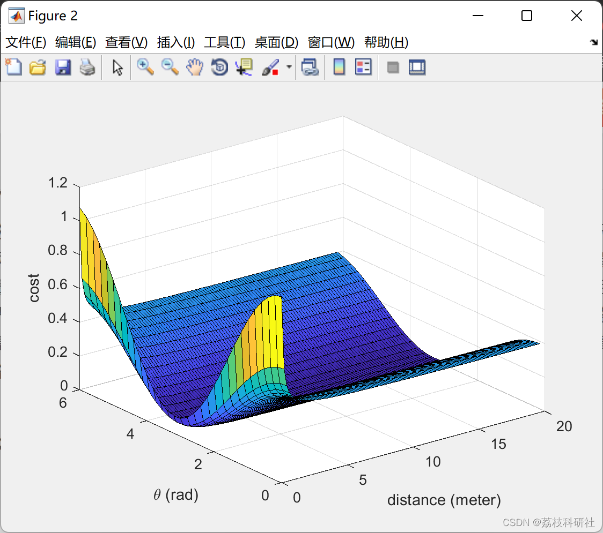
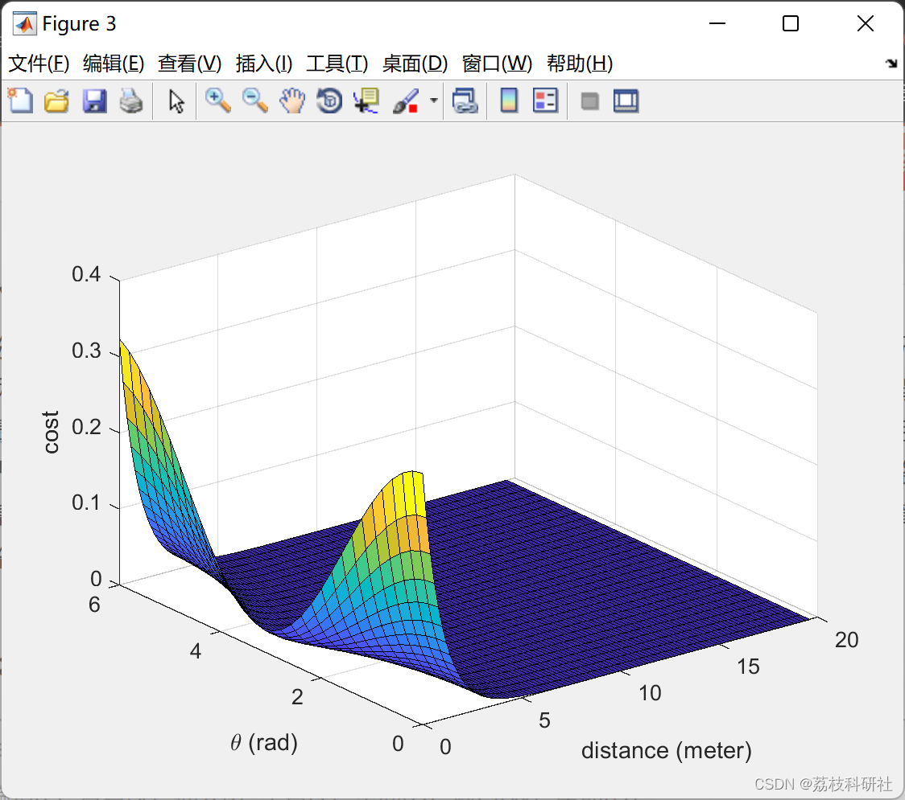
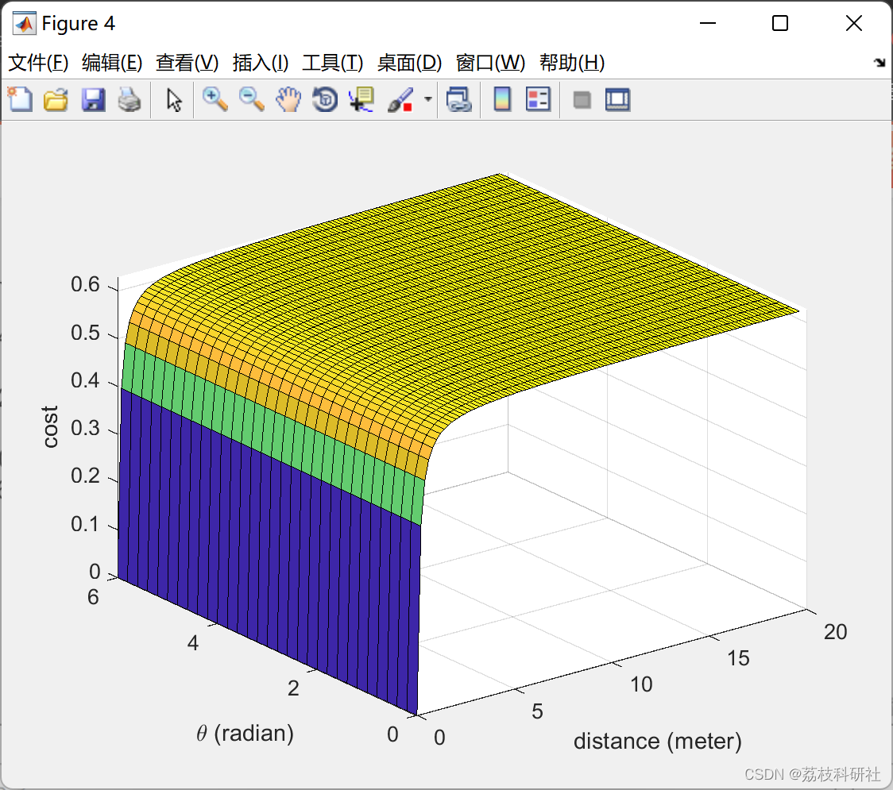

# Unmanned Vehicle Ground Obstacle Avoidance (Matlab Code Implementation)

📚2 Running Results Edit
Edit
Edit
Edit
Part of the code:
clear all;
close all;
x = 0:0.2:0.2*(31-1);
y = 0:0.2:0.2*(100-1);
% Goal point
% Threat obstacle
for iter = 1 : 31
    for iter_j = 1 : 99
        cost(iter,iter_j) = (0.5*cos(x(iter))+0.6)*exp(-(y(iter_j)/y(iter_j+1)));
    end
end
figure(2)
surf(y(1:99),x,cost);
% shading interp;
xlabel('distance (meter)')
ylabel('\theta (rad)')
zlabel('cost')
% Agent
for iter = 1 : 31
    for iter_j = 1 : 99
        cost(iter,iter_j) = 0.3*(0.5*cos(x(iter))+0.6)*exp(-(y(iter_j)));
    end
end
figure(3)
surf(y(1:99),x,cost);
% shading interp;
xlabel('distance (meter)')
ylabel('\theta (rad)')
zlabel('cost')
% Swarm
for iter = 1 : 31
for iter_j = 1 : 99  
cost_goal(iter,iter_j) = 1-exp(-(y(iter_j))/y(iter_j+1));  
end  
end  
x = 0:0.2:0.2*(31-1);  
y = 0:0.2:0.2*(100-1);  
figure(4)  
surf(y(1:99),x,cost_goal);  
% shading interp;  
xlabel('distance (meter)')  
ylabel('\theta (radian)')  
zlabel('cost')  
clear all;  
close all;  
x = 0:0.2:0.2*(31-1);  
y = 0:0.2:0.2*(100-1);  
% goal point  
% threat obstacle  
for iter = 1 : 31  
for iter_j = 1 : 99  
cost(iter,iter_j) = (0.5*cos(x(iter))+0.6)*exp(-(y(iter_j)/y(iter_j+1)));  
end  
end  
figure(2)  
surf(y(1:99),x,cost);  
% shading interp;  
xlabel('distance (meter)')  
ylabel('\theta (rad)')  
zlabel('cost')  
% agent  
for iter = 1 : 31  
for iter_j = 1 : 99  
cost(iter,iter_j) = 0.3*(0.5*cos(x(iter))+0.6)*exp(-(y(iter_j)));  
end  
end  
figure(3)  
surf(y(1:99),x,cost);  
% shading interp;  
xlabel('distance (meter)')  
ylabel('\theta (rad)')  
zlabel('cost')  
% swarm  
for iter = 1 : 31  
for iter_j = 1 : 99  
cost_goal(iter,iter_j) = 1-exp(-(y(iter_j))/y(iter_j+1));  
end  
end  
x = 0:0.2:0.2*(31-1);  
y = 0:0.2:0.2*(100-1);  
figure(4)  
surf(y(1:99),x,cost_goal);  
% shading interp;  
xlabel('distance (meter)')  
ylabel('\theta (radian)')  
zlabel('cost')  
🎉3 References
[2] Fang Pengpeng, Yang Jiafu, Shi Yangyang, Yu Lingyu. Unmanned Vehicle Obstacle Avoidance Method Based on Gradient Descent and Improved Artificial Potential Field [J]. Manufacturing Automation, 2018, 40(11): 81-84.
🌈4 Matlab code implementation

## Images

<!-- PAYMENT_BLOCK -->

## Get this dataset

- Payment link (Stripe): [Buy now](https://buy.stripe.com/3cs8yP7sY87d0vu9AB)
- Payment QR code: 

<!-- /PAYMENT_BLOCK -->
